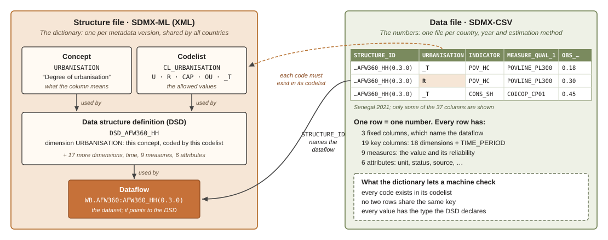

SDMX (Statistical Data and Metadata eXchange) is the ISO standard that
statistical agencies use to publish and exchange statistics. This page
explains the few ideas behind it that matter for AFW 360.

## How SDMX describes a number {#sec-describe}

### Four kinds of column {#sec-components}

In SDMX, one row of data holds **one number plus everything needed to
read it**. Every column of that row is one of four kinds, which SDMX calls
*component types*.

| Component type | The question it answers | In our data |
|-------------|-------------------------|---------------------------------------------------------------|
| **Dimension** | What is this number about? | Country, region, urban or rural, indicator, poverty line, quintile, … |
| **Time dimension** | When? | The reference year |
| **Measure** | How much, and how reliable? | The value, its standard error, confidence interval and sample size |
| **Attribute** | How should I read it? | Unit, status (estimated, missing, …), source, rounding |

: The four SDMX component types {#tbl-components}

Three ideas follow from this:

- **The key.** The dimensions and the time dimension together identify the
  number. No two rows may share the same key, so each combination of codes
  points to exactly one number.
- **Codelists.** A dimension cannot hold free text, only a code from a fixed
  list. Rural is always `R` and the poverty rate is always `POV_HC`, in every
  country and every year.
- **Two reserved codes.** `_T` means *total, not split* (all areas, both
  sexes). `_Z` means *not applicable* (no poverty line is needed for a food
  share). Every key cell is therefore always filled.

### Three indicators from Senegal {#sec-examples}

Three indicators from the Senegal 2021 file, poverty, food share and jobs, show
how this works. Only the key columns that change are shown. In every row the country
is `SEN`, the year is `2021`, and the estimation method is `SURVEY`.

| The number | Value | `URBANISATION` | `INDICATOR` | `MEASURE_QUAL_1` | `MEASURE_QUAL_2` | `COMP_BREAKDOWN_1` |
|---------------------------------------------|----|----------|--------|----------|----------|------------|
| Poverty rate at \$3.00 (2021 PPP), whole country | 0.18 | `_T` | `POV_HC` | `POVLINE_PL300` | `PPP_2021` | `_T` |
| …the same, rural areas only | 0.30 | **`R`** | `POV_HC` | `POVLINE_PL300` | `PPP_2021` | `_T` |
| …the same, at the \$4.20 line | 0.37 | `_T` | `POV_HC` | **`POVLINE_PL420`** | `PPP_2021` | `_T` |
| Food share of consumption (COICOP 01), whole country | 0.45 | `_T` | `CONS_SH` | `COICOP_CP01` | `_Z` | `_T` |
| …the same, poorest quintile | 0.53 | `_T` | `CONS_SH` | `COICOP_CP01` | `_Z` | **`QUINT_Q1`** |
| Share of employed persons working in agriculture | 0.30 | `_T` | `POP_SH` | `_Z` | `_Z` | **`EMP_SECTOR_AGR`** |
| …the same, rural areas only | 0.53 | **`R`** | `POP_SH` | `_Z` | `_Z` | `EMP_SECTOR_AGR` |

: Seven numbers from the Senegal 2021 file, showing only the key columns that vary {#tbl-examples}

Read each row from left to right as a sentence. *Poverty headcount, at
the \$3.00 line, in 2021 PPP, in rural areas: 30 percent.* **Changing one
code changes which number you are looking at.** Swap `R` for `_T` and you
get the national rate. Swap `POVLINE_PL300` for `POVLINE_PL420` and you get
the rate at the higher line.

The values are shares between 0 and 1, never percentages. Each of these
rows also carries the unit (`SHARE`), a status code and the source of the
number, which are attributes and are not shown here.

### Breakdowns and qualifiers {#sec-families}

The dimensions in @tbl-examples do two different jobs. The standard calls
them two *families*:

- A **breakdown** says **who is counted**: rural households, the poorest
  quintile, people living in Fatick. Each category is a *different part* of
  the population.
- A **qualifier** says **what is measured**: at which poverty line, in which
  PPP round, on which consumption category. Each category covers *the same
  people again*.

The quickest test is to ask whether the categories add up:

- **Breakdown: the parts add up to the whole.** The five quintiles together
  are the whole population. Urban and rural together are the whole country.
  The national poverty rate is the population-weighted average of the urban
  and rural rates.
- **Qualifier: every category is the whole again.** The \$3.00 rate (0.18)
  and the \$4.20 rate (0.37) describe the same Senegalese population, measured
  against two different lines, so they do not add up. Food (0.45), housing
  (0.17), transport (0.03) and the other COICOP divisions are all shares of
  the same households' consumption, and the 13 of them sum to 1.

|  | **Breakdown** | **Qualifier** |
|------------------|-----------------------------------------------------|-----------------------------|
| Answers | *Who* is counted | *What* is measured |
| Categories cover | Different parts of the population | The same population every time |
| Population check | Categories **add up** to the whole | Each category **equals** the whole |
| Code when not used | `_T`, total | `_Z`, not applicable |
| Columns | `REF_AREA`, `GEO`, `URBANISATION`, `SEX`, `AGE`, `COMP_BREAKDOWN_1…5` | `INDICATOR`, `MEASURE_QUAL_1…5` |

: The two families of dimensions {#tbl-families-short}

Three dimensions belong to neither family. They frame every number and are
called **reference** dimensions: the frequency (always annual), the
estimation method (survey or model) and the year.

**Why the distinction matters:**

- **Fewer indicators.** There is one poverty rate, `POV_HC`, for every line
  and PPP round, not one indicator per line. There is one consumption share,
  `CONS_SH`, for all 13 COICOP divisions.
- **Automatic checks.** Because the system knows which categories should add
  up, it can test the numbers. Regions must average to the national value,
  and COICOP shares must sum to 1.
- **Growth without new columns.** A new grouping, such as sector of
  employment, or a new poverty line is a new code in a codelist. The file
  format does not change.

## How SDMX stores the data {#sec-storage}

### Two files {#sec-two-files}

SDMX keeps the description of the data separate from the data itself
(@fig-two-files):

1. **The structure file (XML)** is the **dictionary**. It defines every
   column, every allowed code and how they fit together. There is one per
   version of the standard, and every country shares it.
2. **The data file (CSV)** holds the **numbers**: one row per number, with
   its key codes, measures and attributes. There is one file per country,
   year and estimation method.

The two are linked by name. Every row of a data file says which dataflow it
belongs to, in its `STRUCTURE_ID` column, and so which dictionary to check
it against.

{#fig-two-files fig-alt="Diagram of the two SDMX files. On the left, the structure file (XML) contains a concept (URBANISATION) and a codelist (CL_URBANISATION: U, R, CAP, OU, _T), which are both used by the data structure definition DSD_AFW360_HH. The data structure definition is used by the dataflow WB.AFW360:AFW360_HH(0.3.0). On the right, the data file (CSV) shows three Senegal 2021 rows: poverty headcount at 3.00 dollars nationally (0.18) and in rural areas (0.30), and the food share of consumption (0.45). An arrow from the STRUCTURE_ID column points to the dataflow. A dashed arrow from the URBANISATION column points to the codelist, because each code must exist in its codelist."}

Descriptive information, such as survey details, data sources and the
dashboard's explanatory text, travels in further SDMX metadata files. They
are left out of this page.

### The structure file: why it looks complicated {#sec-structure-file}

The structure file is written in SDMX-ML, an XML format, and it is hard to
read by eye. This has three causes:

- **Everything is wrapped in tags.** Names, descriptions and notes each sit
  in their own element, in several languages if needed.
- **Everything has a full identity.** Each item carries an agency, an id and
  a version, for example `WB.AFW360:CL_URBANISATION(0.3.0)`.
- **Everything refers to everything else by that identity.** Items are never
  simply named. A single column of the data file is spread across several
  places that point to one another.

Take the `URBANISATION` column. First, the **codelist** lists its allowed
values. The extract below is shortened: each code also carries notes such
as its status and the global code it matches.

```xml
<str:Codelist agencyID="WB.AFW360" id="CL_URBANISATION" version="0.3.0">
  <com:Name xml:lang="en">Degree of urbanisation</com:Name>
  <com:Description xml:lang="en">Urban and rural areas of residence, with the
    capital city and other urban areas as children of urban.</com:Description>
  <str:Code id="U">
    <com:Name xml:lang="en">Urban</com:Name>
  </str:Code>
  <str:Code id="R">
    <com:Name xml:lang="en">Rural</com:Name>
    <com:Description xml:lang="en">The area is rural.</com:Description>
  </str:Code>
  <!-- CAP (capital city), OU (other urban), _T (total) -->
</str:Codelist>
```

Next, the **data structure definition** declares the column as a dimension.
It does not repeat the name or the codes. It points to the concept that says
what the column means and to the codelist that says which values it takes:

```xml
<str:Dimension id="URBANISATION">
  <str:ConceptIdentity>urn:sdmx:org.sdmx.infomodel.conceptscheme.Concept=WB.AFW360:CS_AFW360(0.3.0).URBANISATION</str:ConceptIdentity>
  <str:LocalRepresentation>
    <str:Enumeration>urn:sdmx:org.sdmx.infomodel.codelist.Codelist=WB.AFW360:CL_URBANISATION(0.3.0)</str:Enumeration>
  </str:LocalRepresentation>
</str:Dimension>
```

Finally, the **dataflow** gives the dataset a name and points to the data
structure definition. Repeat this for 34 columns and 22 codelists, and the
file runs to thousands of lines.

**The benefit is that a machine can check everything.** With the structure
file alone, any SDMX tool knows which columns a data file must have, which
codes each column accepts and what type each value must be. Nobody has to
write those checks by hand.

**Nobody writes it by hand either.** The structure file is generated from
the standard's plain CSV dictionaries, one table per codelist. Those tables
are what people edit.

### The data file: reading a row {#sec-data-file}

The data file is an ordinary CSV, one row per number. Here is one complete
row, rural poverty at \$3.00 from @tbl-examples, read column by column:

| Group | Column | Value | Meaning |
|-----------|-----------------------------|-------------------|----------------------------------------|
| Fixed | `STRUCTURE` | `dataflow` | The row follows a dataflow… |
|  | `STRUCTURE_ID` | `WB.AFW360:AFW360_HH(0.3.0)` | …this one, version 0.3.0 |
|  | `ACTION` | `R` | Replace any earlier value with this one |
| Key: reference | `FREQ` | `A` | Annual |
|  | `ESTIMATION` | `SURVEY` | A direct survey estimate |
|  | `TIME_PERIOD` | `2021` | Reference year |
| Key: breakdowns | `REF_AREA` | `SEN` | Senegal |
|  | `GEO` | `_T` | All regions |
|  | `SEX`, `AGE` | `_T`, `_T` | Both sexes, all ages |
|  | `URBANISATION` | `R` | **Rural areas** |
|  | `COMP_BREAKDOWN_1…5` | `_T` | No further split |
| Key: qualifiers | `INDICATOR` | `POV_HC` | **Poverty headcount rate** |
|  | `MEASURE_QUAL_1` | `POVLINE_PL300` | **At the \$3.00 line** |
|  | `MEASURE_QUAL_2` | `PPP_2021` | **In 2021 PPP** |
|  | `MEASURE_QUAL_3…5` | `_Z` | Not applicable |
| Measures | `OBS_VALUE` | `0.3` | **30 percent** |
|  | `STD_ERR`, `CI_LOWER`, `CI_UPPER`, `N_OBS`, `N_POP`, … | *(empty)* | Not available from the Excel source |
| Attributes | `SERIES_ID` | `POV_HC.POVLINE_PL300.PPP_2021` | The series the row belongs to |
|  | `UNIT_MEASURE` | `SHARE` | A share between 0 and 1 |
|  | `PRECISION` | `0.01` | The source was rounded to two decimals |
|  | `OBS_STATUS` | `A` | Normal value |
|  | `SOURCE_ID` | `SEN_EHCVM2021_LEGACY_v1` | Converted from the Senegal Excel workbook (EHCVM 2021) |
|  | `OBS_COMMENT` | *(empty)* | No comment |

: One complete row of the Senegal 2021 file, grouped by component type {#tbl-full-row}

The reliability measures are empty because this row was converted from the
legacy Excel tables, which hold no standard errors or sample sizes. A
producer working from the microdata fills them in.

A few rules keep every file checkable:

- **Store values unrounded and in base units.** Shares are 0–1, people are
  counted in persons, and money is in whole currency units. Rounding is a
  display decision.
- **Fill every key cell**, using `_T` or `_Z` where nothing else applies.
- **Publish every row the plan requires.** If a number cannot be estimated,
  its row stays in the file with an empty value and a status code that
  explains why. The row is never silently dropped.

## Writing SDMX from R or Stata {#sec-sdmx-csv}

### The tools gap {#sec-tools-gap}

Full SDMX support exists mainly in **Java and Python**. The Java library
behind the Fusion Metadata Registry (FMR) and Python packages such as
`pysdmx` and `sdmx1` can read, write, validate and convert every SDMX format,
including the XML.

**R and Stata have no such writer.** Their SDMX packages, such as `rsdmx` in R
and `sdmxuse` in Stata, are built to *download* data from statistical
agencies, not to produce SDMX files. Yet most country economists compute
their indicators in R or Stata.

The workaround is **SDMX-CSV**. Instead of writing SDMX-ML, a producer
writes an ordinary CSV table laid out the way SDMX-CSV requires. Any R or
Stata user can do that with the commands they already know (`write.csv()`,
`export delimited`). The CSV is a complete, official SDMX format, so it is
also the **intermediate step** to everything else. FMR or `pysdmx` can
validate it against the structure file and, if a user ever needs it, convert
it to SDMX-ML or SDMX-JSON without losing anything.

### What SDMX-CSV is {#sec-what-csv}

SDMX-CSV is the CSV format defined by the SDMX standard itself. We use
version 2.1, which belongs to SDMX 3.1. It is a flat table with **one row per
observation** and **one column per component** of the data structure
definition. Each column header is the component's id (`REF_AREA`,
`INDICATOR`, `OBS_VALUE`, …), and each cell holds a code from the matching
codelist, never a label. Three fixed columns come first. `STRUCTURE` and
`STRUCTURE_ID` say which dataflow, and which version of it, the rows belong
to. `ACTION` says what a receiving system should do with each row, for
example `R` to replace any earlier value.

What makes a plain CSV into SDMX is that link to the structure file. The CSV
holds no definitions of its own. A tool reads `STRUCTURE_ID`, fetches that
dataflow's data structure definition, and from it knows which columns are
dimensions, measures or attributes, which codes are allowed, and which data
types apply. It can then check every row and build any other SDMX format
from the table. Missing values follow fixed conventions: an empty cell means
*not provided*, and `NaN` marks a number that is intentionally missing. A
file written this way is therefore readable by people, easy to produce from
R or Stata, and fully machine-checkable.

## In short {#sec-summary}

- One row is one number. Its **dimensions and year** say what it is, its
  **measures** say how much and how reliable, and its **attributes** say how
  to read it.
- Among the dimensions, **breakdowns** say who is counted and
  **qualifiers** say what is measured.
- SDMX stores this as **two files**: an XML **dictionary**, generated and
  shared by all countries, and a CSV of **numbers**, one per country, year
  and estimation method. Each row of the CSV names the dictionary it follows,
  so any SDMX tool can check it.
- R and Stata cannot write SDMX-ML, so producers write **SDMX-CSV**: a
  plain CSV laid out to the standard, which SDMX tools then validate and, if
  needed, convert to any other SDMX format.
