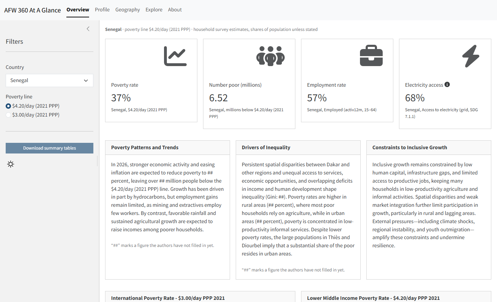

## Legacy dashboard

::: {.tool-card}
::: {.tool-text}
The original AFW 360 dashboard for Senegal and Guinea-Bissau, rebuilt as an
interactive Shiny app. It reads the original Excel tables, unchanged, and
serves as the reference that each later step is checked against.

Published on the World Bank Posit Connect server (World Bank network or VPN
needed): <https://datanalytics-int.worldbank.org/AFW360-v1/>
:::

::: {.tool-thumb}
<a href="https://datanalytics-int.worldbank.org/AFW360-v1/" target="_blank" rel="noopener" title="Open the legacy dashboard in a new window">

Open dashboard ↗
</a>
:::
:::

## Data API

::: {.callout-note appearance="simple"}
**Planned.** A web API that serves the harmonised SDMX data and metadata, so
other tools and users can query them directly.
:::

## Data explorer

::: {.callout-note appearance="simple"}
**Planned.** An interactive page to browse, filter and download the
indicators by country, year and breakdown.
:::

## MCP server

::: {.callout-note appearance="simple"}
**Planned.** A Model Context Protocol server that lets AI assistants look up
the AFW 360 data and metadata.
:::

## Static knowledge website and AI-ready skill

::: {.callout-note appearance="simple"}
**Planned.** A static website with the documentation and data of the
standard, packaged as a skill that AI assistants can load.
:::
